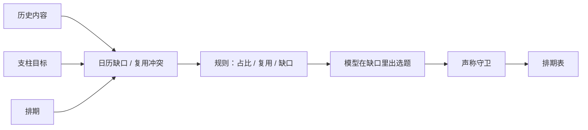

# Draft · content calendar

[](https://github.com/wushiyi105-jpg/draft/actions)

[](./LICENSE)


What to publish today, and which old piece is worth re-running.

## Features

- Compares actual pillar share with the target and warns beyond 10 percentage points.
- Ranks old posts by views for reuse outside a 30-day window.
- Lists empty days in the next 7 days and fills them from the idea backlog.
- Drops any generated idea that claims results (“will go viral”, “gain followers”).

Rules live in `draft/domain/rules/`; the CLI and the web layer only call them. The Chinese README lists every `rule_id` with its penalty.

## Quickstart

```bash
pip install -e ".[dev]"
python -m draft seed
python -m draft plan --month 2026-11
python -m draft ideas --month 2026-11
python -m draft schedule
python -m draft serve        # http://127.0.0.1:8013
```

Run `python -m draft --help` for the full command list; `docker build -t draft . && docker run -p 8013:8013 draft` works the same way.

## Why not just ask a general LLM

A model does not know you published something similar last week, nor that one pillar already takes 75% of the month. Draft computes share, gaps and reuse conflicts locally, then lets the model propose ideas only inside the gaps.

## When to use it

- You run a content account on a fixed cadence.
- Your pillars have drifted and the calendar has holes.

## Roadmap

- Pull view counts from the platform API.
- Import the idea backlog from a spreadsheet.

## FAQ

**Does it publish for me?**
No, it only schedules.

**Can I change the 30-day reuse window?**
Yes, it is a constant in `domain/rules/reuse.py`.

## Commands

See the Chinese README (`README.md`) for the command table with flags; every command supports `--help`.

## Dependencies

FastAPI + Uvicorn, Jinja2, pydantic / pydantic-settings, httpx, Typer + Rich, SQLAlchemy + Alembic; dev extras add pytest, pytest-cov, respx, freezegun, ruff, mypy, pip-audit. Version pinning lives in `uv.lock`.

## How it works



## Layout

```
draft/
├── .github/
│   ├── ISSUE_TEMPLATE
│   ├── PULL_REQUEST_TEMPLATE.md
│   └── workflows
├── assets/
│   └── demo.gif
├── data/
│   ├── draft.db
│   └── seed.json
├── draft/
│   └── … 9 项
├── migrations/
│   ├── __init__.py
│   ├── env.py
│   ├── script.py.mako
│   └── versions
├── prompts/
│   └── ideas.md
├── templates/
│   └── index.html
├── tests/
│   ├── __init__.py
│   ├── conftest.py
│   ├── test_guard_engine.py
│   ├── test_pillars.py
│   ├── test_reuse_calendar.py
│   └── test_web_cli.py
├── CHANGELOG.md
├── CODE_OF_CONDUCT.md
├── CONTRIBUTING.md
├── Dockerfile
├── LICENSE
├── README.en.md
├── README.md
├── SECURITY.md
├── alembic.ini
├── pyproject.toml
```

## Author

shiyi · GitHub [@wushiyi105-jpg](https://github.com/wushiyi105-jpg) · wushiyi105@gmail.com
