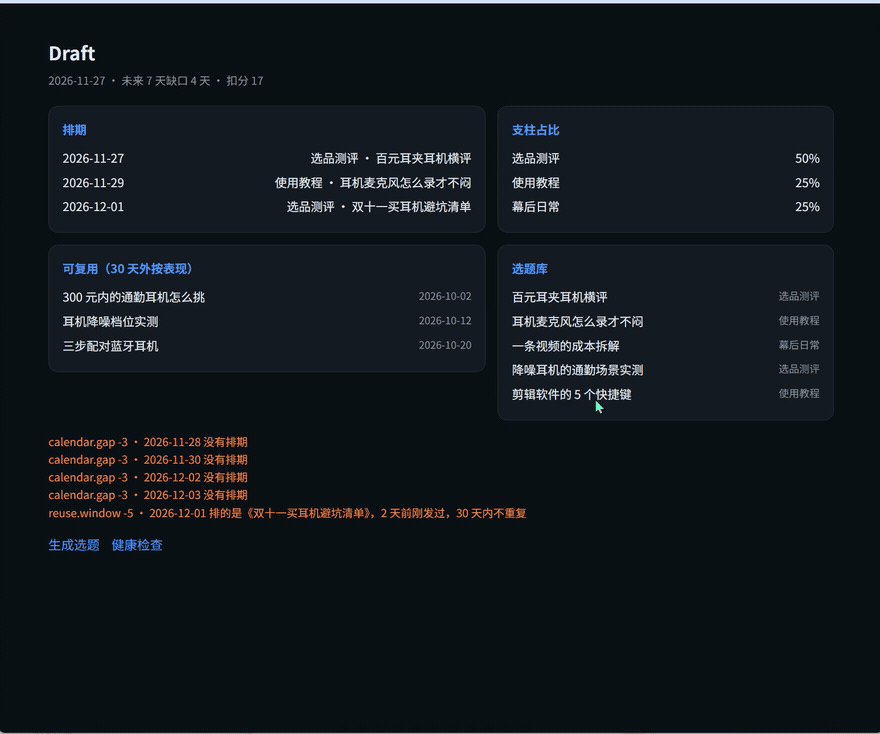

# Draft

[](https://github.com/wushiyi105-jpg/draft/actions)



What to post today, and what to repost.

## What it does

- tracks pillar share against targets;
- only recommends content older than 30 days;
- lists calendar gaps for the next 7 days;
- generates ideas per pillar, always marked unverified;
- drops any idea that claims results.

## Run

```bash
pip install -e ".[dev]"
python -m draft seed
python -m draft plan --month 2026-11
python -m draft serve
```

## Author

shiyi · GitHub [@wushiyi105-jpg](https://github.com/wushiyi105-jpg) · wushiyi105@gmail.com
