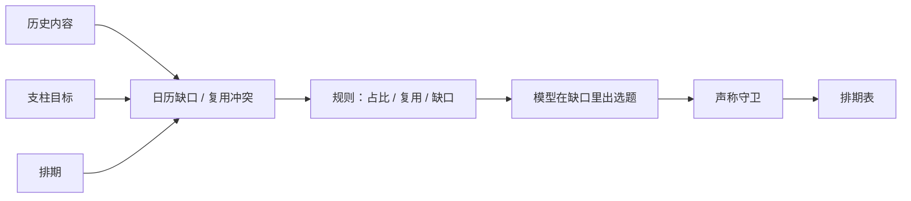

# Draft · 内容运营

[](https://github.com/wushiyi105-jpg/draft/actions)

[](./LICENSE)


今天发什么、旧内容怎么再发一次。


## 功能特性

1. **支柱占比**：实际 vs 目标，差超过 10 个百分点提醒。
2. **复用候选**：30 天以外的旧内容按播放量排序。
3. **日历缺口**：未来 7 天没排期的日期列出来。
4. **选题生成**：模型只按支柱出题，标未验证。
5. **排期**：库存选题自动填缺口。

### 规则与扣分

| rule_id | 含义 | 扣分 |
| --- | --- | --- |
| `pillar.balance` | 支柱占比偏离目标 > 10 个百分点 | 4 |
| `reuse.window` | 30 天内重复推荐 | 5 |
| `calendar.gap` | 未来 7 天有缺口 | 3 |
| `guard.claim` | 声称效果或支柱不在库，丢弃 | 8 |

## 快速开始

```bash
pip install -e ".[dev]"
python -m draft seed
python -m draft plan --month 2026-11
python -m draft ideas --month 2026-11
python -m draft schedule
python -m draft serve        # http://127.0.0.1:8013
```

真实种子：3 个支柱（40% / 35% / 25%）、8 条已发内容、5 个选题、3 条排期。
以 2026-11-27 当天跑 `plan --month 2026-11`：选品测评 50%、使用教程 25%、幕后日常 25%，
选品正好超目标 10 个百分点、没越线，因此没有支柱告警；未来 7 天缺 4 天（11-28、11-30、12-02、12-03）；
12-01 排的是《双十一买耳机避坑清单》，2 天前刚发过，判一条复用冲突；可复用里
《300 元内的通勤耳机怎么挑》播放 12.8 万排第一。合计扣 17 分（4 条日历 + 1 条复用）。

## 为什么不用通用大模型直接问

模型不知道你上周已经发过类似的、不知道「选品测评」已经占到 75%。Draft 先算本月各支柱的实际占比、
30 天内发过的内容不重复推荐、未来 7 天哪天还空着，再让模型在缺口里出选题；生成项一律标未验证，
写了「必火」「涨粉」的直接丢掉。

## 适用场景

- 个人或小团队在运营一个内容号，需要固定的发布节奏。
- 想知道这个月三个内容支柱的占比有没有跑偏。
- 排期空着几天，需要从库存选题里补，而不是临时想。

### 边界

- 不接平台 API，播放量自己录；
- 不自动发布，只排期；
- 生成项都要人过一遍再用。

## Roadmap

- 接平台数据接口，播放量自动回填。
- 选题库批量导入（表格 / 文档）。
- 多账号分别算占比与排期。

## FAQ

**会自动发布吗？**
不会，只排期。

**播放量哪来？**
自己录，工具不接平台 API。

**30 天复用窗口能改吗？**
能，规则在 `domain/rules/reuse.py`，窗口是常量。

**Docker 镜像验证了吗？**
CI 的 `docker` job 每次执行 `docker build .`，启动容器并轮询 `/health`；本机没有 Docker，本地未重复跑。

## 命令参考

| 命令 | 作用 | 常用参数 |
| --- | --- | --- |
| `seed` | 写入支柱、历史内容、选题与排期。 | --db |
| `plan` | 看占比、缺口与复用候选。 | --month, --db |
| `stats` | 按支柱看播放量。 | --db |
| `ideas` | 模型出选题（无 key 时只列库存）。 | --month, --db |
| `schedule` | 把库存选题填进未来 7 天缺口。 | --day, --db |
| `doctor` | 四项体检。 | --db |
| `serve` | Web 界面。 | --port, --db |

全部命令都支持 `--help`；只读命令不带参数时读默认库 `data/draft.db`，写命令用 `--db` 指到别的库。

## 依赖说明

| 依赖 | 为什么装 | 不装会怎样 |
| --- | --- | --- |
| `fastapi` + `uvicorn[standard]` | Web 入口与 ASGI 服务 | 只有命令行，没有页面 |
| `jinja2` | 服务端渲染模板 | 页面出不来 |
| `pydantic` + `pydantic-settings` | 配置与数据结构校验，`.env` 直接生效 | 配置散在代码里，改端口要改源码 |
| `httpx` | 调模型与 webhook 的 HTTP 客户端 | 模型层与推送都不可用 |
| `typer` + `rich` | 命令行与终端表格 | 只能用 curl 调接口 |
| `sqlalchemy` + `alembic` | 本地库与迁移 | 表结构变更只能删库重来 |
| `pytest` / `pytest-cov` / `respx` / `freezegun`（dev） | 单测、覆盖率、HTTP 打桩、冻结时间 | 规则改动没有回归保护 |
| `ruff` / `mypy` / `pip-audit`（dev） | 风格、类型、依赖漏洞检查 | CI 只看测试，类型错误会漏进主干 |

装了 `uv` 的话，`uv sync --extra dev` 会按 `uv.lock` 装同一套版本。

## 工作原理




domain 里是支柱占比、复用窗口、日历缺口与声称守卫；app 负责排期。

## 目录结构

```
draft/
├── .github/
│   ├── ISSUE_TEMPLATE
│   ├── PULL_REQUEST_TEMPLATE.md
│   └── workflows
├── assets/
│   └── demo.gif
├── data/
│   ├── draft.db
│   └── seed.json
├── draft/
│   └── … 9 项
├── migrations/
│   ├── __init__.py
│   ├── env.py
│   ├── script.py.mako
│   └── versions
├── prompts/
│   └── ideas.md
├── templates/
│   └── index.html
├── tests/
│   ├── __init__.py
│   ├── conftest.py
│   ├── test_guard_engine.py
│   ├── test_pillars.py
│   ├── test_reuse_calendar.py
│   └── test_web_cli.py
├── CHANGELOG.md
├── CODE_OF_CONDUCT.md
├── CONTRIBUTING.md
├── Dockerfile
├── LICENSE
├── README.en.md
├── README.md
├── SECURITY.md
├── alembic.ini
├── pyproject.toml
```

## 质量与供应链

- CI 的 Coverage 步骤带 `--fail-under=70`，覆盖率低于 70% 直接失败。
- `tests/test_app_fake.py` 用真实 `InMemoryStore` 跑主用例，并显式标注 `StorePort` 交给 mypy 做结构校验；测试不创建 SQLite 文件。
- Audit 步骤用 `pip-audit --path` 扫描虚拟环境的 site-packages，跳过本地可编辑包；第三方依赖有漏洞就让 job 失败，不用 `|| true` 吞错。

## 作者

罗之之 · GitHub [@wushiyi105-jpg](https://github.com/wushiyi105-jpg) · 15071889700
