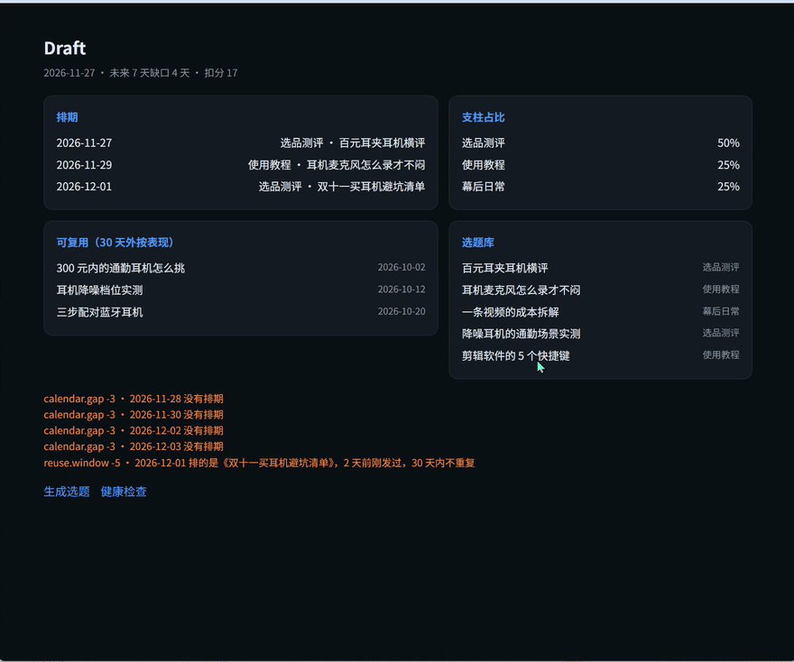

# Draft · 内容运营

[](https://github.com/wushiyi105-jpg/draft/actions)

[](./LICENSE)



今天发什么、旧内容怎么再发一次。

## 为什么不是让模型每天想五个标题

模型不知道你上周已经发过类似的、不知道「选品测评」已经占到 75%。Draft 先算本月各支柱的实际占比、
30 天内发过的内容不重复推荐、未来 7 天哪天还空着，再让模型在缺口里出选题；生成项一律标未验证，
写了「必火」「涨粉」的直接丢掉。

## 它做什么

1. **支柱占比**：实际 vs 目标，差超过 10 个百分点提醒。
2. **复用候选**：30 天以外的旧内容按播放量排序。
3. **日历缺口**：未来 7 天没排期的日期列出来。
4. **选题生成**：模型只按支柱出题，标未验证。
5. **排期**：库存选题自动填缺口。

## 怎么用

```bash
pip install -e ".[dev]"
python -m draft seed
python -m draft plan --month 2026-11
python -m draft ideas --month 2026-11
python -m draft schedule
python -m draft serve        # http://127.0.0.1:8013
```

真实种子：3 个支柱（40% / 35% / 25%）、8 条已发内容、5 个选题、3 条排期。
以 2026-11-27 当天跑 `plan --month 2026-11`：选品测评 50%、使用教程 25%、幕后日常 25%，
选品正好超目标 10 个百分点、没越线，因此没有支柱告警；未来 7 天缺 4 天（11-28、11-30、12-02、12-03）；
12-01 排的是《双十一买耳机避坑清单》，2 天前刚发过，判一条复用冲突；可复用里
《300 元内的通勤耳机怎么挑》播放 12.8 万排第一。合计扣 17 分（4 条日历 + 1 条复用）。

## 规则与扣分

| rule_id | 含义 | 扣分 |
| --- | --- | --- |
| `pillar.balance` | 支柱占比偏离目标 > 10 个百分点 | 4 |
| `reuse.window` | 30 天内重复推荐 | 5 |
| `calendar.gap` | 未来 7 天有缺口 | 3 |
| `guard.claim` | 声称效果或支柱不在库，丢弃 | 8 |

## 边界

- 不接平台 API，播放量自己录；
- 不自动发布，只排期；
- 生成项都要人过一遍再用。

## 作者

shiyi · GitHub [@wushiyi105-jpg](https://github.com/wushiyi105-jpg) · wushiyi105@gmail.com
